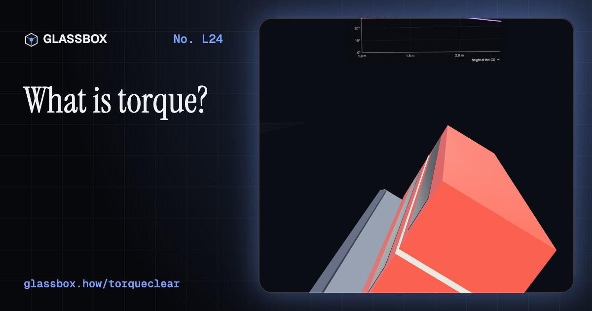
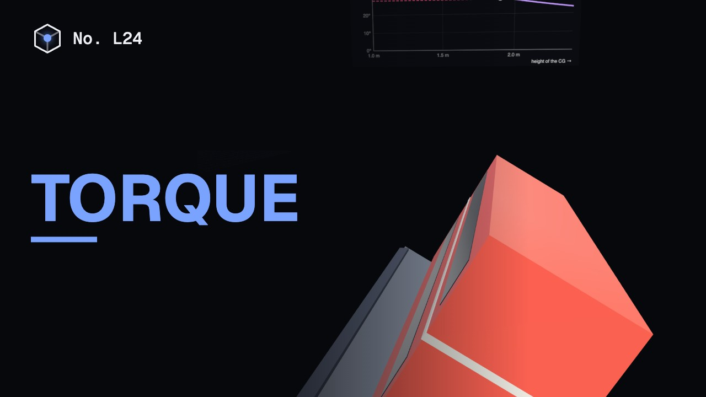
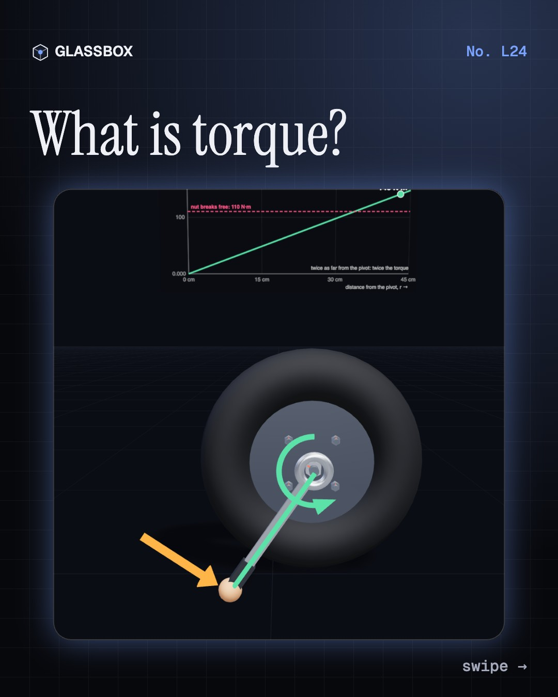
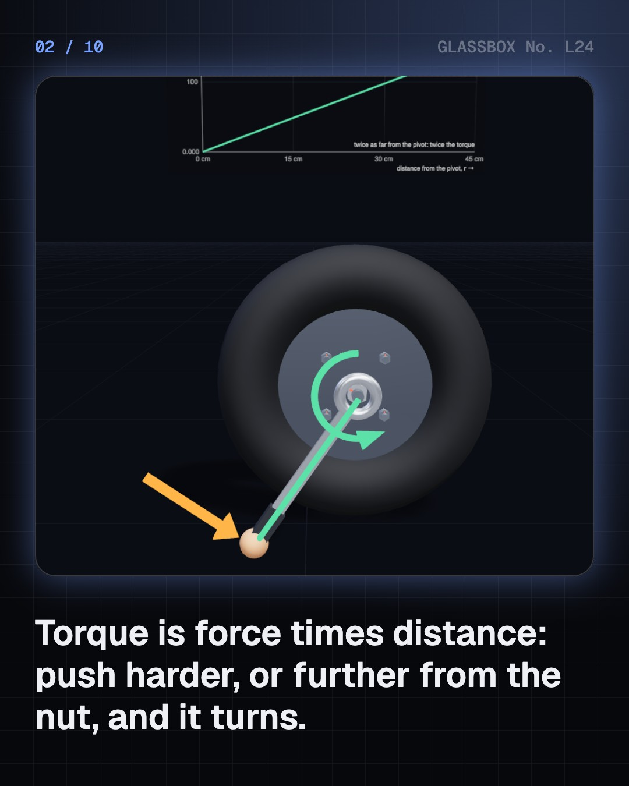
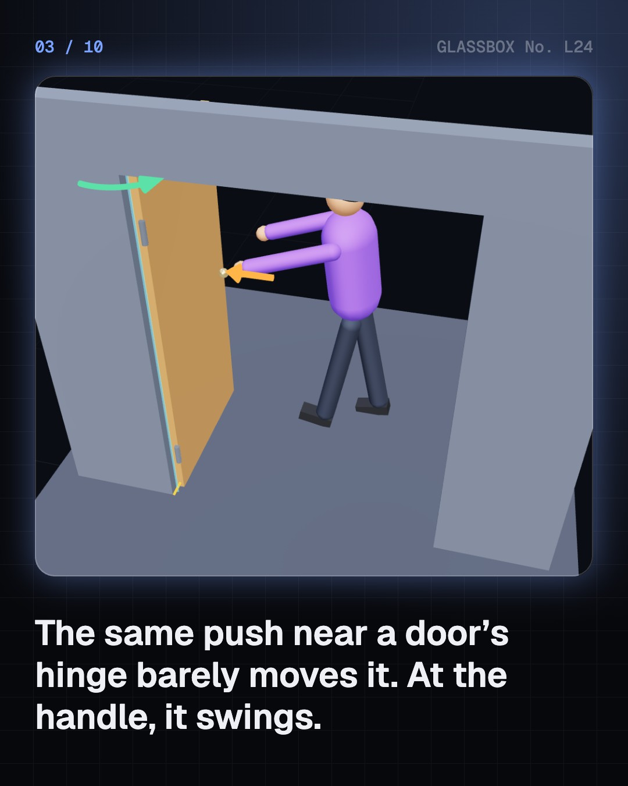
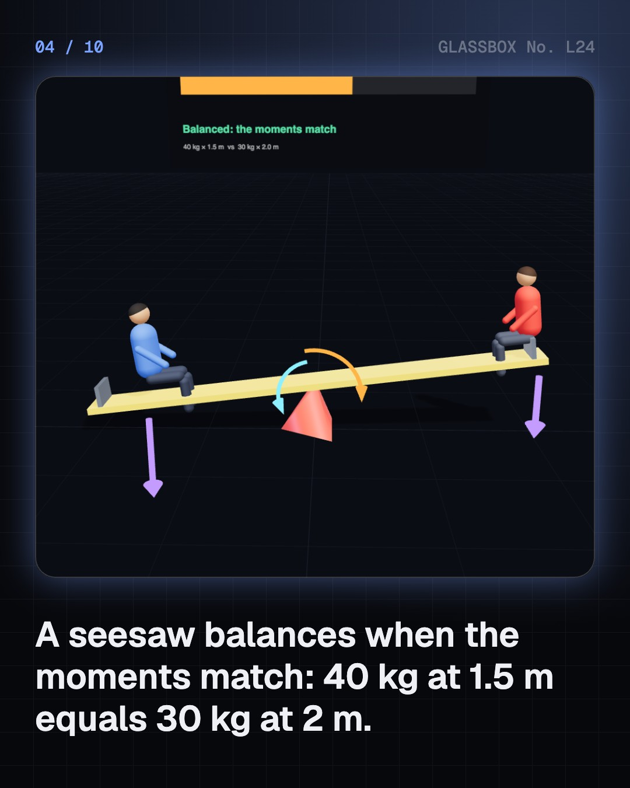

<!-- glassbox:start -->
<!-- Generated from glassbox.json by the Glassbox hub (npm run readme -- torqueclear). Edit glassbox.json, not this block. -->
<p align="center"><a href="https://glassbox-production-fd52.up.railway.app/e/torqueclear/"></a></p>

<h1 align="center">Torque</h1>

<p align="center"><b>What is torque?</b><br>Torque is what turns things: a push times its distance from the pivot. Undo a stuck wheel nut, balance a seesaw, tip a double-decker bus, test an engine on a brake, crack a walnut, and watch a gyroscope refuse to fall.</p>

<p align="center"><a href="https://glassbox-production-fd52.up.railway.app/torqueclear/"><b>▶ Play with it</b></a> &nbsp;·&nbsp; <a href="https://glassbox-production-fd52.up.railway.app/e/torqueclear/">Read the 60-second explainer</a> &nbsp;·&nbsp; <a href="https://glassbox-production-fd52.up.railway.app/torqueclear/glassbox/reel.mp4">Watch the 40-second video</a></p>

<p align="center">
  <a href="https://glassbox-production-fd52.up.railway.app/e/torqueclear/"></a>
  <a href="https://glassbox-production-fd52.up.railway.app/e/torqueclear/"></a>
  <a href="LICENSE"></a>
  <a href="LICENSE-CONTENT.md"></a>
  <a href="#privacy"></a>
</p>

## In 60 seconds

1. **Force times distance.** Torque is the turning effect of a force: τ = F × r, in newton-metres. Only the part of the push at right angles counts, τ = F r sin θ. A stuck nut turns only when your torque beats its breakaway torque, and a door swings fastest when you push at the handle.
2. **Balance.** An object stays still when the clockwise and anticlockwise moments match: m₁d₁ = m₂d₂ on a seesaw. It stands while the line down from its centre of gravity falls inside its base, which is why double-decker buses are tilted to 28° in a test. A tightrope walker's pole slows the fall.
3. **Machines that turn.** A 17 cm bicycle crank turns your push into torque, and the gears change it at the wheel. On a test brake, a 1.2 litre engine makes about 113 N·m, a mixer under 1 N·m. Power is torque × spin speed, P = τω, so the fast little mixer still makes hundreds of watts.
4. **Torque in your hands.** When a job needs a set torque, a bigger radius means less force: steering wheels, fat screwdriver handles, nutcrackers and a pipe on a wheel brace. A torque wrench clicks at the right torque. Your biceps works the other way, pulling about nine times the load.
5. **Spin, wobble and myths.** Unbalanced torque spins things up, τ = Iα. A gyroscope's torque swings its spin round instead of tipping it. Torque and work share N·m but differ: a stuck nut gets no joules. A longer spanner gives more torque, not more force, and speed comes from power, not torque.

## Words worth knowing

| Term | Meaning |
|---|---|
| **Torque** | The turning effect of a force: force × distance from the pivot, at right angles. |
| **Newton-metre (N·m)** | The unit of torque: 1 newton pushing at right angles 1 metre from the pivot. |
| **Lever arm** | The shortest distance from the pivot to the line of a force, r sin θ. |
| **Principle of moments** | For balance, the clockwise moments about a pivot equal the anticlockwise moments. |
| **Centre of gravity** | The point where an object's whole weight seems to act. It must stay above the base for the object to stand. |
| **Gear ratio** | Teeth on the driven gear ÷ teeth on the driving gear: it multiplies torque and divides speed. |
| **Power = τω** | For anything that turns, power is torque × angular speed in radians per second. |
| **Precession** | The slow swing of a spinning object's axis when a torque acts at right angles to its spin. |

## A short history

**From the steelyard in a Greek market to the torque figure on a car's spec sheet: how people learned that a push is worth more further from the pivot.**

- **250 BCE** · The law of the lever (Archimedes, Syracuse, Sicily)
- **1500** · The 'potential lever' (Leonardo da Vinci, Milan)
- **1687** · Varignon's theorem (Pierre Varignon, Paris)
- **1765** · Torque makes things spin up (Leonhard Euler, Berlin)
- **1821** · The Prony brake measures torque (Gaspard de Prony, Paris)
- **1852** · The gyroscope gets its name (Léon Foucault, Paris)
- **1884** · The word 'torque' (James Thomson, Glasgow)
- **1888** · Motors that twist with magnetism (Galileo Ferraris and Nikola Tesla, Turin and New York)

The full story, with 20 moments, charts, people and 22 sources: [glassbox.how/e/torqueclear/history](https://glassbox-production-fd52.up.railway.app/e/torqueclear/history/). The data lives in [`history.json`](history.json).

## Video and slides

Made with the Glassbox studio from this box's storyboard (`window.glassbox.director`). Free to reuse under CC BY 4.0.

<a href="https://glassbox-production-fd52.up.railway.app/torqueclear/glassbox/video.mp4"></a>

<p><a href="glassbox/slide-1.jpg"></a> <a href="glassbox/slide-2.jpg"></a> <a href="glassbox/slide-3.jpg"></a> <a href="glassbox/slide-4.jpg"></a></p>

| File | What | Size |
|---|---|---|
| [`glassbox/reel.mp4`](https://glassbox-production-fd52.up.railway.app/torqueclear/glassbox/reel.mp4) | Reel / Short, with captions and soundtrack | 1080×1920 |
| [`glassbox/video.mp4`](https://glassbox-production-fd52.up.railway.app/torqueclear/glassbox/video.mp4) | YouTube video, with captions and soundtrack | 1920×1080 |
| `glassbox/slide-1…10.jpg` | Instagram carousel | 1080×1350 |
| `glassbox/thumb.jpg` | YouTube thumbnail | 1280×720 |
| `glassbox/cover.jpg` | Share card and repo social preview | 1200×630 |
| [`glassbox/history-reel.mp4`](https://glassbox-production-fd52.up.railway.app/torqueclear/glassbox/history-reel.mp4) | “History in 10 moments” Reel / Short | 1080×1920 |
| `glassbox/history-slide-*.jpg` | History carousel | 1080×1350 |
| `glassbox/post.json` | Post copy and schedule used by the publish kit | |

## Privacy

This box has no accounts and no ads, and it ships its own fonts and libraries. When you run it yourself it sends nothing anywhere. On glassbox.how, the site's `/bar.js` also loads Glassbox's analytics: **Google Analytics** to count visits (it asks first in the EU, UK and Switzerland, and stays off when your browser sends Global Privacy Control or Do Not Track) and **ClickTrust** to detect bots.

It remembers a few things **in your own browser only**, and never sends them anywhere:

| Browser storage key | What it holds |
|---|---|
| `torqueclear.v1` | Which chapters you have opened, your best quiz scores, and sound on or off. |

Exactly what each one sees is at [glassbox.how/privacy](https://glassbox-production-fd52.up.railway.app/privacy/).

## Licences

- **Code:** [MIT](LICENSE). Use it, change it, ship it.
- **Explanations, text, images and videos** (`glassbox.json`, `glassbox/`): [CC BY 4.0](LICENSE-CONTENT.md). Credit “Glassbox, glassbox.how/e/torqueclear”.
- **Third-party parts** keep their own licences: [three.js](https://threejs.org) (MIT), [Geist, Instrument Serif](https://openfontlicense.org) (SIL OFL 1.1).
- The Glassbox name and logo aren't covered by either licence. See the [terms](https://glassbox-production-fd52.up.railway.app/terms/).

Found a mistake? [Open an issue](https://github.com/bdeeps/torqueclear/issues). Corrections happen in public.
<!-- glassbox:end -->

## Run it

It's plain HTML, CSS and JavaScript. No build step and no dependencies. Run locally, it contacts no other website.

```bash
python3 -m http.server 8000
```

Three.js and the fonts ship in `vendor/` and `fonts/`, so it also works offline.

Then open http://localhost:8000.

## How it's built

| File | What |
|---|---|
| `index.html`, `css/app.css` | The page and its styles |
| `js/app.js`, `js/stage.js`, `js/ui.js`, `js/kit.js` | The shared Glassbox 3D engine: chapters, 3D stage, controls, quiz, video director |
| `js/torque.js` | Shared parts: torque and force formatting, chart boards, straight force arrows and curled torque arrows, a hex nut, spanners, gears, seated children and people |
| `js/chapters/*.js` | One file per chapter: the 3D model, controls, text, key terms, quiz and video scenes |
| `glassbox.json` | Title, question, explainer beats, key terms, browser storage and credits shown on glassbox.how |
| `reel` in each chapter | The storyboard the Glassbox studio records into short videos |
| `glassbox/` | The published video, slides, thumbnail and post copy |
| `fonts/`, `vendor/three/` | Self-hosted Geist and Instrument Serif (SIL OFL 1.1) and three.js (MIT) |
